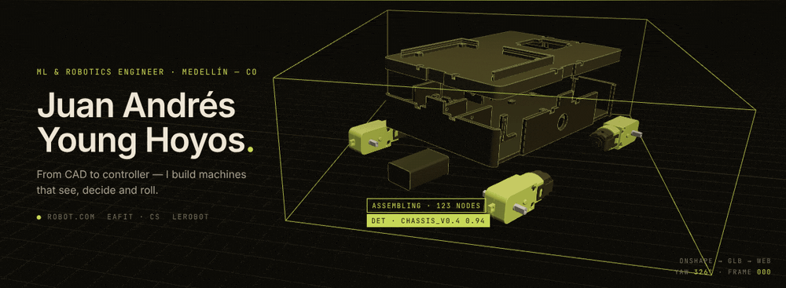
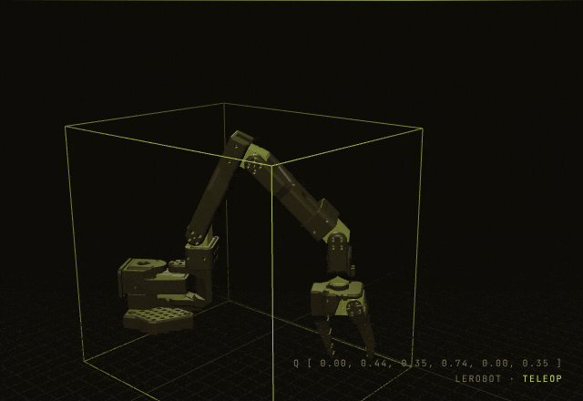
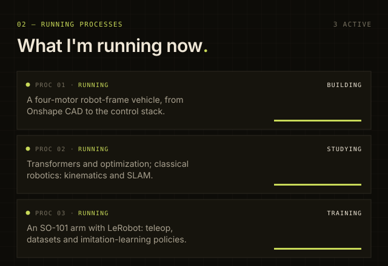
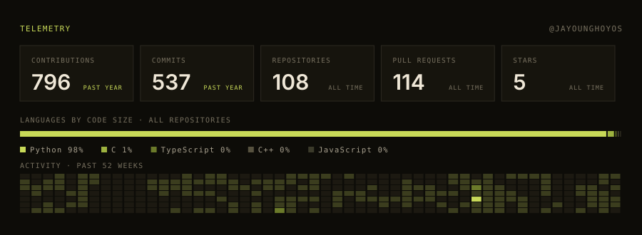
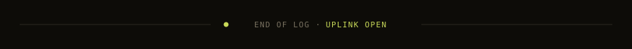

  
  
  

 

**Computer Science student at EAFIT University, working at the intersection of machine learning and robotics.** Most of what I build starts as a question about how a physical thing should behave, and ends as code, a circuit, or something that rolls. Day job at **Robot.com**; nights spent on CAD, controllers and learning policies.

 

  
  

 

  

 

  
  

